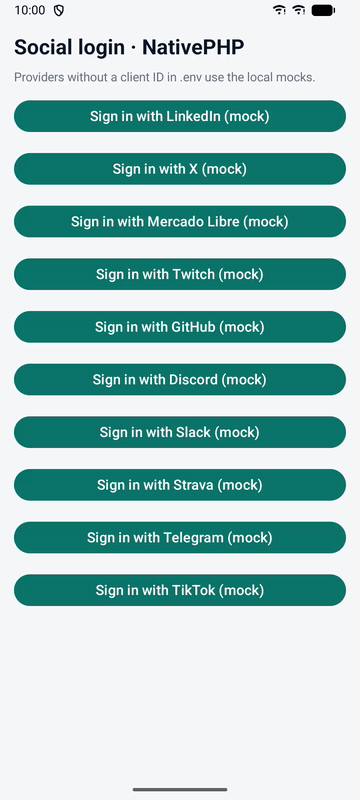

# nativephp-social-login

<p align="center">
  
</p>

<p align="center">

[](https://packagist.org/packages/franciscodlxdev/nativephp-social-login) [](https://github.com/franciscodlx/nativephp-social-login/actions/workflows/ci.yml) [](LICENSE)

</p>

**Agrega "Iniciar sesión con GitHub, X, LinkedIn, TikTok…" a tu app de NativePHP Mobile con una sola API: navegador del sistema, PKCE y cero secrets en la app.**

Sin WebView: el usuario inicia sesión en `ASWebAuthenticationSession` (iOS) o Custom Tabs (Android), con las cookies y gestores de contraseñas que ya usa. El `client_secret` se queda en tu backend, y los errores llegan normalizados (`CANCELLED`, `NETWORK`, `PROVIDER_ERROR`…) sin importar el proveedor.

## Instalación

```sh
composer require franciscodlxdev/nativephp-social-login
php artisan native:plugin:register franciscodlxdev/nativephp-social-login
```

Agrega a tu `.env` el esquema de tu app: `SOCIAL_LOGIN_REDIRECT_SCHEMES=miapp`. Con eso el plugin configura Android solo; iOS no necesita nada.

## Ejemplo mínimo

```php
use Franciscodlxdev\SocialLogin\Events\AuthSessionCompleted;
use Franciscodlxdev\SocialLogin\Facades\SocialLogin;
use Native\Mobile\Attributes\On;
use Native\Mobile\Edge\NativeComponent;

class Login extends NativeComponent
{
    public string $hello = '';

    public function signIn(): void
    {
        SocialLogin::signIn(SocialLogin::x(), [
            'clientId' => 'TU_CLIENT_ID',        // portal de X → OAuth 2.0, app tipo "Native App"
            'redirectUri' => 'miapp://callback', // regístrala tal cual en X
            'exchangeCode' => true,              // cliente público: canje en el dispositivo con PKCE
        ]);
    }

    #[On(AuthSessionCompleted::class)]
    public function completed(string $url): void
    {
        $this->hello = 'Hola, @'.SocialLogin::complete($url)->profile['username'];
    }
}
```

X es un cliente público, así que este ejemplo no necesita backend. LinkedIn, GitHub, TikTok y los demás devuelven un `code` que tu backend canjea con el secret; cada paquete trae el canje listo en Node y Laravel. Detalles de X en [`packages/social-login`](packages/social-login).

<sub>El GIF: App `examples/demo` (Laravel + pantalla nativa de NativePHP 4) en el emulador de Android contra el proveedor local (`tools/mock-idp`). Probado también con cuentas reales de LinkedIn, X, GitHub, Discord, Telegram y TikTok en iPhone.</sub>

## Paquete

| Paquete                                                                  | Qué hace                                                                 | Estado           |
| ------------------------------------------------------------------------ | ------------------------------------------------------------------------ | ---------------- |
| [`franciscodlxdev/nativephp-social-login`](packages/social-login)         | Plugin de NativePHP (Swift + Kotlin) y los 10 proveedores en PHP          | Probado en iPhone con LinkedIn, X, GitHub, Discord, Telegram y TikTok |

Los 10 proveedores pasan contra `tools/mock-idp` y los backends de `tools/` en iOS (simulador) y Android (emulador); los de la tabla, además, con cuentas reales en iPhone.

A diferencia de las versiones en TypeScript, aquí todo va en un solo paquete de Composer. Un plugin de NativePHP es un paquete, y en PHP los proveedores son solo configuración (endpoints, scopes y mapeo del perfil), como los drivers de Socialite. Entra External ID (native auth) todavía no está en esta versión.

## Estructura

```
packages/social-login       plugin: PHP (flujo y proveedores), Swift, Kotlin, manifiesto nativephp.json
examples/demo               app Laravel + NativePHP 4 (pantalla nativa) con todos los proveedores
tools/mock-idp              proveedor OAuth/OIDC local, sin credenciales reales
tools/<proveedor>-backend   backends de ejemplo: redirect https y canje con el secret
```

## Desarrollo

Requiere PHP 8.3+, Composer, Node 22+ (mocks y backends), Xcode, y Android SDK con JDK 17.

```sh
cd packages/social-login && composer install && composer test
```

Probar el flujo completo, sin cuenta en ningún proveedor: ver [CONTRIBUTING.md](CONTRIBUTING.md). Vulnerabilidades: [SECURITY.md](SECURITY.md).

## La familia

La misma API, los mismos proveedores y los mismos códigos de error en cada plataforma:

| Plataforma | Repositorio |
| ---------- | ----------- |
| React Native (y Expo) | [rn-social-login](https://github.com/franciscodlx/rn-social-login) |
| Flutter | [flutter_social_login](https://github.com/franciscodlx/flutter_social_login) |
| Capacitor / Ionic | [capacitor-social-login](https://github.com/franciscodlx/capacitor-social-login) |
| NativeScript | [nativescript-social-login](https://github.com/franciscodlx/nativescript-social-login) |
| NativePHP Mobile | **este repo** |

## Licencia

MIT
